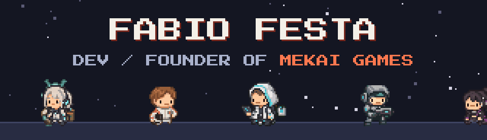
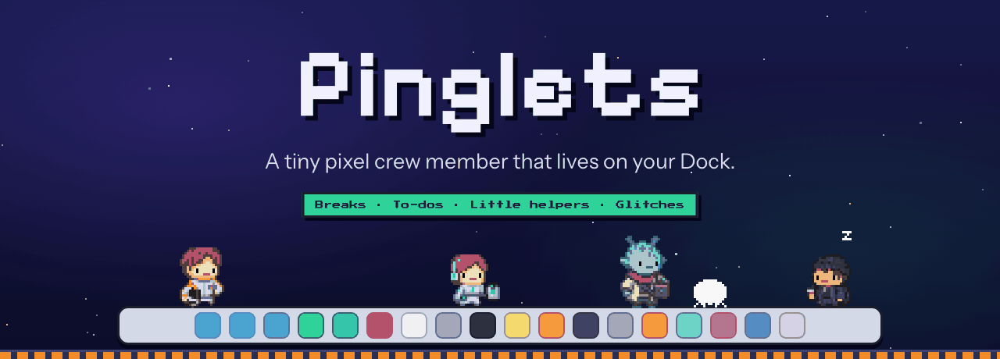
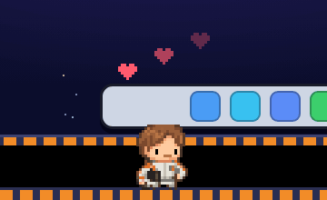
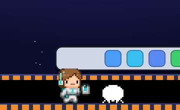
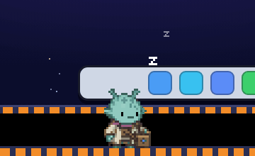
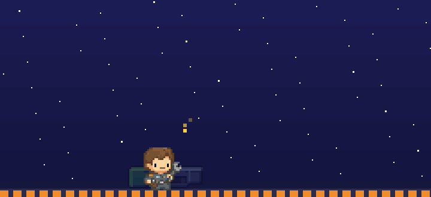
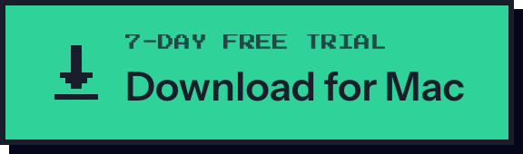
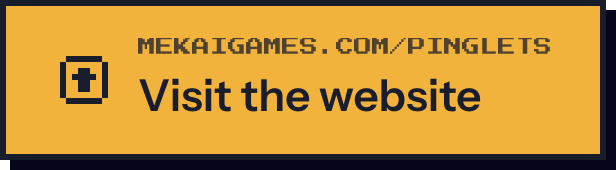
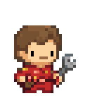

  

  
  

  

<h3 align="center">Hi, I'm Fabio 👋</h3>

  Developer and founder of <a href="https://mekaigames.com"><b>Mekai Games</b></a>, a game studio from Italy. 
  I build mobile games, PC games for Steam, pixel art asset packs and, lately, little apps that live on your desktop.

---

## ⭐ Featured: Pinglets

  

  <b>A tiny pixel crew member that lives on your Dock or taskbar.</b> 
  It flies on focus missions while you work, plays games with you right on the desktop, reminds you to take breaks,
  keeps your to-dos and tidies your desktop. It even builds its own little lab.

  
  
  
  

<table>
  <tr>
    <td align="center" width="33%"> <b>It needs you</b> Food, mood, energy and a wash now and then, like a tiny Tamagotchi.</td>
    <td align="center" width="33%"> <b>Glitches</b> Skip a break or a reminder and a glitch shows up. Do the task and it's gone.</td>
    <td align="center" width="33%"> <b>It rests too</b> Quiet at night and while you focus. It saves its questions for later.</td>
  </tr>
</table>

   
  Building mode: your crew member finds parts on missions and hammers its own lab together, piece by piece.

  
  &nbsp;
  
  &nbsp;
  

  Public page, releases and bug reports: <a href="https://github.com/mekai-games/pinglets">mekai-games/pinglets</a>

## 🎮 Also from Mekai Games

<table>
  <tr>
    <td width="33%" align="center">
      
       <b>GRAVENTH</b>
       Cave-diving action on Steam
    </td>
    <td width="33%" align="center">
      
       <b>Tidy Tiles</b>
       Cozy sliding puzzle on iOS
    </td>
    <td width="33%" align="center">
      
       <b>Mine Fever</b>
       Pixel art mining roguelite on iOS
    </td>
  </tr>
</table>

Everything else: <a href="https://github.com/mekai-games">github.com/mekai-games</a> · <a href="https://mekaigames.com">mekaigames.com</a>

## 🛠️ What I work with

  
  
  
  
  
  
  

  

